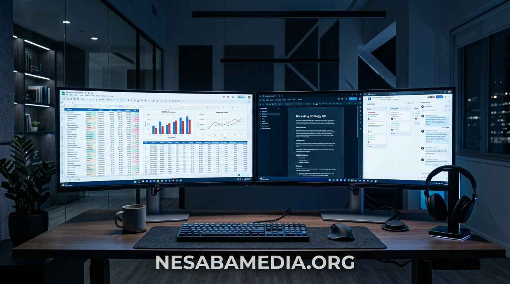
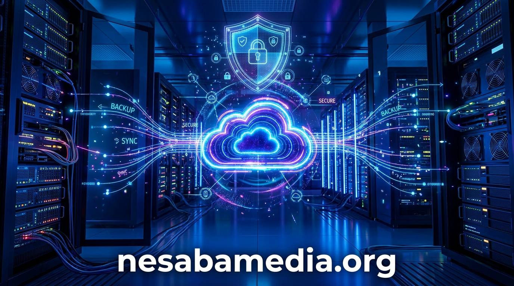

# Panduan Lengkap Software Produktivitas PC - Nesabamedia

Dalam era komputasi modern, pemilihan perangkat lunak atau software produktivitas memegang peranan krusial dalam menentukan kelancaran operasional harian, baik untuk kalangan pelajar, mahasiswa, profesional mandiri, hingga korporasi berskala besar. Komputer tanpa dukungan piranti lunak yang memadai ibarat mesin bertenaga tinggi tanpa kemudi; potensi optimalnya tidak akan pernah tercapai tanpa aplikasi yang dirancang khusus untuk memfasilitasi pengolahan dokumen, analisis data, pembuatan presentasi interaktif, serta pengelolaan komunikasi berkas secara terstruktur. Artikel mendalam ini menyajikan ulasan menyeluruh mengenai seluk-beluk software produktivitas, standar spesifikasi perangkat keras penunjang, langkah verifikasi keamanan berkas instalasi, tips optimasi sistem operasi Windows, hingga strategi pencadangan data guna mencegah kerugian akibat insiden digital tak terduga.

---

## Apa Saja Kebutuhan Pokok Pengguna Komputer Terhadap Software Produktivitas di Era Digital?

Kebutuhan pengguna komputer saat ini telah berkembang jauh melampaui kemampuan pengetikan teks sederhana. Transformasi digital menuntut efisiensi tinggi, kompatibilitas berkas lintas platform, serta integrasi sistematis antara aplikasi pengolah kata, spreadsheet kalkulatif, dan media presentasi multimedia.

### Mengapa Pengolahan Dokumen dan Lembar Kerja Menjadi Pondasi Utama Produktivitas?

Pengolahan dokumen formal, laporan keuangan berkala, proposal bisnis, dan inventarisasi stok memerlukan aplikasi yang stabil dan memiliki akurasi komputasi tinggi. Format dokumen standar seperti berkas pengolah kata (.docx), lembar kerja kalkulasi (.xlsx), serta dokumen portabel (.pdf) telah menjadi bahasa komunikasi universal dalam dunia profesional. Tanpa alat yang mampu membaca, memodifikasi, dan mengekspor dokumen ini dengan tata letak presisi, alur komunikasi antar lembaga akan mengalami hambatan signifikan. Ketepatan formula matematika, pembuatan tabel dinamis (pivot tables), hingga pemformatan bersyarat adalah fitur-fitur esensial yang secara konsisten dibutuhkan untuk menyederhanakan data mentah menjadi wawasan bisnis yang siap dipresentasikan kepada para pemangku kepentingan.

### Bagaimana Software Perkantoran Modern Meningkatkan Efisiensi Kerja Tim dan Individu?

Aplikasi produktivitas kontemporer tidak hanya berfungsi sebagai lembar kerja mandiri, melainkan wadah orkestrasi kolaboratif. Penggunaan fitur komentar kontekstual, pelacakan perubahan (track changes), serta riwayat revisi memungkinkan banyak individu bekerja pada berkas yang sama tanpa risiko tumpang tindih versi. Efisiensi ini memangkas waktu birokrasi pengiriman draf bolak-balik melalui surel tradisional hingga lebih dari separuh durasi kerja normal. Bagi pengguna individu, otomatisasi tata bahasa, templat siap pakai beresolusi tinggi, dan integrasi pintasan keyboard tingkat lanjut mempercepat penyusunan tugas akademis maupun pekerjaan kantor rutin secara nyata.

### Apa Saja Fitur Kolaborasi Real-Time yang Paling Banyak Dibutuhkan Saat Ini?

Di tengah tren kerja jarak jauh (remote working) dan model kerja hibrida (hybrid working), kolaborasi waktu nyata telah bertransformasi dari sekadar fitur pelengkap menjadi kebutuhan mutlak. Sinkronisasi perubahan karakter per karakter secara instan, penanda kursor rekan kerja di layar yang sama, integrasi obrolan langsung di dalam jendela pengeditan dokumen, serta manajemen hak akses bertingkat (viewer, commenter, editor) memastikan integritas data tetap terlindungi sekaligus menjaga alur pertukaran ide tetap dinamis tanpa distorsi komunikasi.

---

## Bagaimana Memilih Antara Software Berbasis Langganan Cloud dan Lisensi Permanen (Offline)?

Dilema paling sering dihadapi oleh pengambil keputusan teknologi informasi maupun pengguna rumahan adalah memilih antara ekosistem berbasis langganan periodik (Software as a Service - SaaS) atau membeli lisensi permanen (stand-alone perpetual license) yang terpasang penuh di memori lokal.

### Apa Kelebihan dan Kekurangan Memakai Software Berbasis Cloud?

Model berbasis langganan cloud menawarkan keuntungan utama berupa pembaruan fitur berkelanjutan tanpa biaya tambahan di masa mendatang, akses penyimpanan berbasis awan berkapasitas besar, serta kemudahan instalasi di berbagai perangkat (laptop, tablet, ponsel pintar). Pengguna selalu menikmati versi terbaru dengan tambalan keamanan paling mutakhir. Kendati demikian, model ini menuntut biaya operasional rutin yang terus berjalan setiap bulan atau tahun. Apabila langganan dihentikan, akses pengeditan dokumen akan dibatasi secara ketat, menyisakan mode baca saja (read-only), yang dapat menjadi beban finansial tersendiri bagi pengguna dengan anggaran terbatas.

### Kapan Pengguna Lebih Membutuhkan Software Konvensional yang Terinstal Penuh Secara Lokal?

Sebaliknya, versi perangkat lunak konvensional yang diinstal secara lokal pada perangkat keras menawarkan kepastian biaya sekali bayar untuk pemakaian jangka panjang tanpa batas waktu kadaluarsa. Model ini sangat ideal bagi instansi atau individu yang bekerja di lingkungan dengan koneksi internet terbatas, daerah terpencil, atau area kerja dengan protokol keamanan data ketat di mana transfer informasi ke server publik dilarang keras. Keuntungan lainnya adalah stabilitas antarmuka pengguna; pengguna tidak perlu beradaptasi secara mendadak dengan perubahan menu atau letak tombol fungsi yang kerap terjadi pada pembaruan aplikasi cloud otomatis.

### Bagaimana Menghitung Efisiensi Biaya Jangka Panjang Antara Model Berlangganan dan Pembelian Putus?

Untuk mengevaluasi opsi yang paling ekonomis, pengguna disarankan melakukan simulasi Total Cost of Ownership (TCO) dalam rentang waktu tiga hingga lima tahun. Jika total akumulasi biaya langganan tahunan selama 36 bulan melampaui harga satu lisensi permanen sebesar dua kali lipat, dan kebutuhan kolaborasi awan harian tidak terlalu mendesak, maka opsi lisensi lokal permanen menjadi investasi yang jauh lebih rasional secara finansial. Sebaliknya, bagi organisasi dinamis yang membutuhkan pergantian lisensi cepat antar staf baru, fleksibilitas langganan bulanan memberikan ruang pergerakan modal kerja yang lebih cair.

---

## Bagaimana Menentukan Spesifikasi Minimum Komputer Agar Software Berjalan Cepat Tanpa Lag?

Seringkali pengguna mengeluhkan lambatnya waktu peluncuran aplikasi atau terjadinya penurunan respons (freeze) saat memproses berkas berukuran besar. Masalah ini sebagian besar berakar pada ketidaksesuaian antara tuntutan komputasi perangkat lunak dengan konfigurasi perangkat keras yang tersedia di dalam unit komputer.

### Berapa Kapasitas RAM dan Ruang Penyimpanan Minimum yang Ideal untuk Pekerjaan Berat?

Meskipun persyaratan dasar yang tertera pada kotak pembungkus software seringkali menyebutkan memori 4 GB RAM sebagai batas minimum, realitas kerja komputasi modern dengan sistem operasi Windows 10 atau Windows 11 membutuhkan setidaknya 8 GB RAM untuk pengoperasian standar yang lancar. Untuk skenario kerja berat yang melibatkan pembukaan lembar kerja dengan puluhan ribu baris data, penggunaan rumus matriks kompleks, serta pemuatan aset grafik vektor resolusi tinggi pada presentasi, kapasitas 16 GB RAM dengan konfigurasi dual-channel adalah standar emas baru guna menghindari penggunaan memori virtual (paging file) yang memperlambat sistem. Ruang penyimpanan bebas minimal 20 GB hingga 50 GB pada partisi sistem (Drive C:) juga wajib dipertahankan agar berkas sementara (temp files) dapat diproses tanpa memicu peringatan kapasitas penuh.

### Mengapa Menggunakan Solid State Drive (SSD) Jauh Lebih Disarankan Daripada Hard Disk Biasa?

Penggantian hard disk mekanis tradisional (HDD) dengan Solid State Drive (SSD), terutama tipe NVMe M.2, merupakan langkah peningkatan kinerja paling signifikan yang dapat dirasakan seketika oleh pengguna. Kecepatan baca dan tulis acak (random read/write IOPS) pada SSD yang ratusan kali lebih tinggi daripada piringan magnetik HDD mampu memangkas waktu booting aplikasi pengolah kata dan spreadsheet dari sebelumnya 30-45 detik menjadi kurang dari 3 detik saja. Efek instan ini menghilangkan lag saat fungsi auto-save berjalan di latar belakang, meminimalkan jeda waktu respons saat berpindah antar jendela kerja, serta memperpanjang usia pakai baterai laptop berkat efisiensi daya konsumsi memori kilat.

### Apa Peran Kartu Grafis dan Prosesor Multi-Core dalam Menjalankan Komputasi Kompleks?

Aplikasi perkantoran modern kini memanfaatkan akselerasi perangkat keras grafis (Hardware Graphics Acceleration) guna merender antarmuka pengguna, animasi transisi slide presentasi beresolusi 4K, serta manipulasi objek tiga dimensi (3D models). Prosesor modern dengan konfigurasi minimal 4 core fisik dan 8 threads menjamin pembagian beban kerja komputasi berjalan seimbang, di mana satu core dapat menangani kalkulasi lembar data di latar belakang sementara core lainnya menjaga antarmuka grafis tetap responsif terhadap input ketikan keyboard dan klik mouse pengguna.

---

## Bagaimana Cara Mengamankan dan Memverifikasi Integritas File Sebelum Melakukan Instalasi?

Keamanan siber merupakan fondasi yang tidak boleh dikompromikan saat mengunduh paket penginstal perangkat lunak dari internet. Distribusi berkas digital rentan terhadap penyisipan kode berbahaya yang dapat merusak data pribadi atau mengeksploitasi sumber daya komputer tanpa sepengetahuan pemiliknya.

### Apa Saja Bahaya Nyata yang Muncul Akibat Mengunduh File dari Sumber yang Meragukan?

Mengunduh arsip penginstal dari portal web yang tidak memiliki rekam jejak jelas membawa risiko kontaminasi trojan dropper, adware agresif, spyware pencuri kredensial perbankan, hingga ransomware pengenkripsi data. Dalam banyak kasus, berkas berbahaya sengaja dibundel di dalam installer palsu yang tampak meyakinkan. Saat installer dieksekusi dengan hak akses administrator, muatan berbahaya tersebut menyusup ke dalam direktori sistem System32, mematikan proteksi Windows Defender, serta mendaftarkan proses tersembunyi pada Windows Registry yang berjalan otomatis setiap kali komputer dinyalakan.

### Bagaimana Memeriksa Checksum SHA-256 dan Tanda Tangan Digital pada Paket Installer?

Sebelum menjalankan berkas instalasi berekstensi .exe atau .msi, pengguna yang bijak selalu memverifikasi integritas berkas menggunakan nilai hash kriptografis seperti SHA-256 atau MD5. Melalui perintah PowerShell sederhana Get-FileHash namafile.exe -Algorithm SHA256, nilai hash keluaran dapat dicocokkan dengan nilai resmi yang dipublikasikan oleh pengembang sah. Jika terdapat perbedaan satu karakter saja pada string hash tersebut, maka berkas tersebut dipastikan telah mengalami modifikasi, kerusakan unduhan, atau injeksi kode asing, sehingga harus segera dihapus. Selain itu, klik kanan pada file, pilih menu Properties, dan periksa tab Digital Signatures untuk memastikan sertifikat pengembang sah masih valid dan belum kedaluwarsa.

### Mengapa Memilih Portal Referensi Terpercaya Seperti ms office nesabamedia Sangat Dianjurkan?

Dalam mencari ulasan, panduan komparasi fitur, dan tautan informasi software yang akurat, pengguna membutuhkan rujukan media teknologi independen yang memiliki reputasi kredibel serta konsistensi dalam mengedukasi masyarakat. Memilih portal referensi berbobot seperti <a href="https://nesabamedia.org" target="_blank" rel="noopener noreferrer">ms office nesabamedia</a> memberikan keuntungan berupa panduan langkah demi langkah yang terstruktur rapi, penjelasan persyaratan sistem yang transparan, ulasan bebas bias mengenai kelebihan serta kekurangan tiap versi aplikasi, serta panduan pemecahan kendala teknis yang disajikan dalam bahasa Indonesia yang mudah dipahami oleh pembaca pemula sekalipun. Keberadaan panduan yang komprehensif membantu pengguna menghindari kesalahan konfigurasi fatal sejak awal tahapan instalasi.

---

## Apa Saja Masalah Umum yang Sering Muncul Saat Menjalankan Software Produktivitas dan Cara Mengatasinya?

Meskipun sistem komputer telah dipersiapkan dengan baik, konflik dependensi sistem dan korupsi berkas konfigurasi tetap dapat menimbulkan galat operasional. Mengetahui kode kesalahan umum beserta langkah mitigasinya menghemat waktu konsultasi teknis yang mahal.

### Mengapa Muncul Pesan Kesalahan Missing DLL Files Seperti VCRUNTIME140.dll atau MSVCP140.dll?

Pesan galat yang menyatakan bahwa file pustaka dinamis (Dynamic Link Library / DLL) tertentu tidak ditemukan merupakan masalah paling lazim yang dialami setelah proses instalasi aplikasi baru. Galat seperti *VCRUNTIME140.dll missing* atau *MSVCP140.dll not found* terjadi karena sistem operasi belum terpasang paket pustaka runtime Visual C++ Redistributable yang dibutuhkan oleh compiler aplikasi tersebut. Solusinya sangat lugas: jangan pernah mengunduh file .dll satuan dari situs acak di internet, melainkan pasanglah paket resmi Microsoft Visual C++ Redistributable (versi x86 dan x64 sekaligus) langsung dari repositori resmi Microsoft untuk memperbarui seluruh pustaka dependensi secara terpadu dan aman.

### Bagaimana Cara Mengatasi Crash Tiba-Tiba Saat Membuka Dokumen yang Sangat Besar?

Penutupan aplikasi secara mendadak (force close) saat membuka dokumen berukuran ratusan megabita umumnya dipicu oleh kehabisan alokasi ruang memori pada arsitektur perangkat lunak 32-bit (yang dibatasi maksimal 2 GB RAM per proses) atau karena adanya kerusakan pada add-in pihak ketiga. Langkah penanganan pertama adalah membuka aplikasi dalam Mode Aman (Safe Mode) dengan menahan tombol Ctrl saat mengklik ikon aplikasi. Jika aplikasi berjalan stabil dalam Safe Mode, nonaktifkan seluruh add-in eksternal (terutama add-in konverter PDF pihak ketiga atau pemeriksa ejaan usang) melalui menu Options > Add-ins > COM Add-ins. Pertimbangkan pula untuk beralih ke instalasi versi 64-bit guna memanfaatkan alokasi memori komputer secara penuh tanpa batasan virtual.

### Apa Langkah Terbaik Ketika Muncul Peringatan Konflik Lisensi atau Registry Rusak?

Munculnya peringatan berulang mengenai status aktivasi yang belum tervalidasi atau jendela pop-up error aktivasi seringkali disebabkan oleh keberadaan sisa registri dari versi lama yang pernah terpasang sebelumnya di komputer. Konflik data lisensi ini dapat diatasi dengan membersihkan token cache aktivasi menggunakan alat pembersih resmi (seperti Microsoft Support and Recovery Assistant / SaRA). Pengguna dapat menjalankan script pembersihan lisensi via command prompt pengelola administrator (cscript ospp.vbs /dstatus dan cscript ospp.vbs /unpkey:XXXXX) untuk menghapus kunci produk lama yang bertubrukan sebelum memasukkan lisensi baru yang sah.

---

## Bagaimana Cara Merawat Sistem Operasi Agar Kinerja Aplikasi Perkantoran Tetap Stabil?

Performa aplikasi produktivitas sangat terikat dengan kesehatan ekosistem sistem operasi Windows secara keseluruhan. Tanpa perawatan rutin yang terencana, penumpukan data residual dan driver perangkat keras yang usang akan mengakibatkan degradasi performa bertahap.

### Seberapa Penting Memperbarui Driver Perangkat Keras dan Paket Visual C++ Redistributable?

Banyak pengguna beranggapan bahwa pembaruan driver hanya diperlukan untuk bermain video game, padahal driver kartu grafis, chipset motherboard, dan kontroler penyimpanan SSD memegang peranan krusial dalam mempercepat kalkulasi antarmuka aplikasi kantor modern. Driver grafis yang mutakhir memastikan fitur DirectWrite dan Direct2D berjalan mulus dalam merender tipografi teks tajam pada monitor beresolusi tinggi (High-DPI). Menjaga driver dan paket dependensi runtime tetap mutakhir juga menutup celah keamanan zero-day yang seringkali dieksploitasi oleh peretas melalui berkas makro jahat.

### Bagaimana Cara Membersihkan File Sampah (Temporary Files) dan Cache Sistem Secara Berkala?

Setiap kali pengguna membuat, mengedit, dan menyimpan dokumen, sistem membuat berkas salinan cadangan sementara di direktori %temp% dan AppData. Seiring berjalannya waktu, ribuan berkas sementara yang tidak terhapus otomatis dapat menumpuk hingga puluhan gigabita, memperlambat proses pencarian indeks file (Windows Search Indexer) dan memicu fragmentasi ruang penyimpanan. Pengguna dapat mengaktifkan fitur otomatis Storage Sense pada menu Settings Windows, atau menjalankan utilitas Disk Cleanup bawaan untuk membersihkan Temporary Internet Files, Windows Error Reporting Logs, dan DirectX Shader Cache secara aman tanpa khawatir menghapus dokumen pribadi penting.

### Apa Pengaruh Software Antivirus Terhadap Kecepatan Eksekusi Program Produktivitas?

Program perlindungan antivirus berbasis real-time scanning yang bekerja terlalu agresif dapat menjadi penyebab utama lambatnya proses pembukaan berkas dokumen perkantoran. Setiap kali file dokumen dibuka, antivirus akan memindai struktur berkas, memeriksa tanda tangan makro, dan menganalisis tautan tautan eksternal sebelum mengizinkan aplikasi membacanya. Untuk mengoptimalkan kinerja tanpa mengorbankan keamanan, pengguna disarankan menambahkan direktori kerja utama dokumen resmi ke dalam daftar pengecualian pemindaian perilaku (behavioral exclusion list) antivirus terpercaya, atau memastikan modul antimalware menggunakan pemindaian berbasis awan yang hemat sumber daya prosesor.

---

## Bagaimana Strategi Terbaik untuk Melindungi Dokumen dari Kehilangan Data Mendadak?

Kehilangan naskah kerja berhari-hari akibat pemadaman listrik tiba-tiba, kegagalan mekanis komponen penyimpanan, atau infeksi malware adalah mimpi buruk terbesar bagi setiap pengguna komputer. Membangun sistem redundansi cadangan data merupakan investasi perlindungan paling fundamental.

### Mengapa Sistem Auto-Recovery dan Riwayat Versi Dokumen Menjadi Penyelamat Utama?

Software produktivitas modern dilengkapi dengan fungsi AutoRecover yang secara berkala menyimpan snapshot berkas setiap beberapa menit (dapat diatur manual ke interval 1 atau 2 menit pada preferensi pengaturan). Fitur ini menjamin bahwa jika sistem mengalami crash mendadak, pekerjaan pengguna dapat dipulihkan hampir mendekati kondisi pengetikan terakhir. Lebih jauh lagi, fitur riwayat versi (Version History) memungkinkan pengguna membatalkan kesalahan pengeditan besar dengan kembali ke titik waktu spesifik beberapa jam atau hari sebelumnya, menyelamatkan dokumen dari kekeliruan logika formula atau penghapusan lembar kerja yang tidak disengaja.

### Bagaimana Menerapkan Aturan Pencadangan 3-2-1 untuk File Kerja yang Sangat Krusial?

Standar industri dalam manajemen proteksi data merekomendasikan penerapan formula cadangan 3-2-1. Prinsip ini mensyaratkan: simpan minimal **tiga (3)** salinan data penting (satu berkas utama dan dua cadangan), simpan salinan tersebut dalam minimal **dua (2)** media penyimpanan fisik yang berbeda jenis (contohnya di SSD internal komputer dan satu lagi di Hard Disk Eksternal atau NAS lokal), serta tempatkan minimal **satu (1)** salinan cadangan di lokasi fisik yang berbeda secara geografis (off-site backup), yang paling praktis diwujudkan melalui layanan penyimpanan awan terenkripsi. Dengan skenario ini, bahkan jika komputer utama mengalami kerusakan fisik total atau terkena musibah, berkas berharga tetap dapat diakses kembali dalam hitungan menit.

### Kapan Harus Memilih Backup Eksternal Dibandingkan Sinkronisasi Otomatis ke Cloud?

Sinkronisasi otomatis ke cloud sangat praktis untuk kolaborasi harian, namun memiliki satu kelemahan fatal: jika berkas di komputer lokal terinfeksi atau terenkripsi oleh ransomware, proses sinkronisasi otomatis dapat secara tidak sengaja mengunggah berkas yang rusak tersebut ke server awan dan menimpa versi sebelumnya. Oleh karena itu, pencadangan ke drive eksternal yang menggunakan metode *air-gapped* (kabel dicabut dari port USB setelah proses pencadangan selesai) tetap menjadi benteng pertahanan terakhir yang tak tergantikan dalam menghadapi ancaman serangan siber terorganisir.

---

## Apa Saja Alternatif Software Produktivitas Sumber Terbuka (Open Source) yang Dapat Dipertimbangkan?

Meskipun paket aplikasi komersial mendominasi pasar global, ekosistem perangkat lunak sumber terbuka (open source) menawarkan alternatif yang sangat mumpuni, transparan, serta sepenuhnya bebas dari biaya lisensi berkala.

### Apakah Software Sumber Terbuka Mampu Membaca Format Berkas Standar Industri Tanpa Rusak?

Pertanyaan paling mendasar bagi calon pengguna software sumber terbuka (seperti LibreOffice atau Apache OpenOffice) adalah masalah kompatibilitas format. Berkat pengembangan filter impor dan ekspor yang matang selama bertahun-tahun, paket aplikasi sumber terbuka masa kini mampu membuka, mengedit, dan menyimpan dokumen berekstensi .docx, .xlsx, dan .pptx dengan tingkat presisi tata letak yang mencapai lebih dari 95%. Perbedaan minor biasanya hanya ditemukan pada dokumen yang menggunakan makro visual basic (VBA) tingkat lanjut, tipografi font eksklusif yang tidak terpasang di sistem operasi, atau grafik pivot dengan kalkulasi hierarki majemuk.

### Siapa Saja Kelompok Pengguna yang Paling Diuntungkan dengan Beralih ke Solusi Bebas Biaya Ini?

Lembaga pendidikan nirlaba, sekolah, pegiat usaha mikro kecil dan menengah (UMKM), serta instansi pemerintahan yang mengutamakan kedaulatan data dan penghematan anggaran belanja teknologi merupakan target pengguna yang paling tepat untuk mengadopsi software open source. Menggunakan perangkat lunak bebas lisensi membebaskan entitas bisnis dari risiko hukum pelanggaran hak cipta intelektual serta audit lisensi mendadak, sembari memberikan kendali penuh terhadap keamanan kode program yang dapat diaudit secara mandiri oleh komunitas pengembang global.

### Apa Saja Keterbatasan Utama yang Masih Sering Ditemukan pada Aplikasi Alternatif?

Kendala yang paling sering dikeluhkan oleh pengguna saat berpindah ke software alternatif adalah kurva pembelajaran antarmuka (interface learning curve) dan ketiadaan fitur kolaborasi awan terintegrasi secara bawaan. Aplikasi open source umumnya mempertahankan tata letak menu klasik berbasis toolbar dropdown, berbeda dengan tampilan ribbon modern yang telah menjadi kebiasaan mayoritas pekerja kantoran. Selain itu, integrasi penyimpanan awan memerlukan konfigurasi manual pihak ketiga (seperti Nextcloud atau ownCloud), yang menuntut pengetahuan teknis manajemen server tersendiri bagi administrator jaringan.

---

## Bagaimana Pengaruh Perkembangan Kecerdasan Buatan (AI) Terhadap Cara Kita Menggunakan Software?

Lanskap perangkat lunak produktivitas saat ini sedang mengalami pergeseran paradigma paling masif dalam dua dekade terakhir berkat integrasi model bahasa besar (Large Language Models / LLM) dan agen kecerdasan buatan terapan langsung di dalam lembar kerja harian.

### Bisakah Fitur Copilot dan Otomatisasi AI Menggantikan Tugas Administrasi Rumit?

Kehadiran asisten AI cerdas di dalam aplikasi kantor memungkinkan transformasi perintah bahasa manusia sehari-hari (natural language prompt) menjadi tindakan komputasi nyata seketika. Pengguna kini tidak perlu lagi menghafal sintaksis rumus matematika rumit seperti nested IF atau kombinasi INDEX-MATCH; cukup mengetikkan instruksi seperti *"Buat ringkasan perbandingan laba bersih per kuartal dan sorot angka minus dengan warna merah"*, maka sistem AI akan menyusun formula dan tabel visualisasi yang tepat dalam hitungan detik. Asisten AI juga mampu merangkum berkas presentasi puluhan halaman menjadi ringkasan eksekutif tiga paragraf padat, menghemat ratusan jam kerja manual per tahun bagi para profesional sibuk.

### Apa Saja Keterampilan Teknis Baru yang Harus Dikuasai oleh Pengguna Komputer Masa Depan?

Dengan diambil alihnya tugas pengetikan mekanis dan kalkulasi dasar oleh mesin pintar, fokus kompetensi manusia beralih ke ranah rekayasa instruksi (*prompt engineering*), validasi data analitis, dan kemampuan berpikir kritis (*critical thinking*). Pengguna dituntut memiliki kecermatan tinggi dalam memeriksa kemungkinan halusinasi AI (kondisi di mana sistem menyajikan data fiktif dengan nada meyakinkan), memahami logika etika pengolahan data rahasia, serta mampu mengarahkan output kecerdasan buatan agar selaras dengan panduan identitas dan tata bahasa resmi organisasi kerja masing-masing.

### Bagaimana Menjaga Privasi dan Keamanan Data Perusahaan Saat Menggunakan Asisten AI?

Tantangan terbesar dalam pemanfaatan AI pada dokumen perkantoran adalah kebocoran kerahasiaan informasi internal. Ketika staf memasukkan laporan laba rugi rahasia atau data pribadi pelanggan ke dalam asisten AI berbasis cloud, ada risiko data tersebut dijadikan bahan pelatihan (training dataset) model publik penyedia layanan. Pengguna dan pengelola IT wajib meninjau klausul Service Level Agreement (SLA) dan kebijakan privasi korporasi, memastikan enkripsi end-to-end terpasang, serta mengaktifkan mode proteksi data komersial (commercial data protection) yang menjamin seluruh data percakapan dan dokumen tidak akan disimpan atau ditinjau oleh pihak ketiga.

---

## Apa Kesimpulan dan Langkah Praktis Terbaik dalam Membangun Ekosistem Kerja Digital yang Kuat?

Membangun lingkungan kerja komputer yang produktif, aman, dan berdaya tahan tinggi memerlukan perpaduan seimbang antara pemilihan perangkat lunak yang andal, pemeliharaan perangkat keras yang konsisten, penerapan disiplin keamanan digital, serta adaptasi proaktif terhadap inovasi teknologi mutakhir.

### Apa Rangkuman Prioritas Utama yang Harus Dilakukan Pengguna Komputer Hari Ini?

Sebagai rangkuman langkah praktis harian, pastikan komputer Anda memenuhi spesifikasi minimum dengan prioritasi pada upgrade media penyimpanan ke SSD berkecepatan tinggi dan alokasi RAM minimal 8 GB hingga 16 GB. Selalu unduh dan pelajari informasi perangkat lunak melalui portal referensi yang terpercaya, verifikasi nilai checksum integritas berkas sebelum menjalankan installer, pasang pustaka pendukung resmi seperti Visual C++ Redistributable, bersihkan berkas temporary secara berkala, dan tegakkan disiplin backup data cadangan mengikuti metode 3-2-1. Dengan mempraktikkan panduan komprehensif ini, Anda memastikan seluruh alur komputasi harian berjalan stabil tanpa interupsi teknis yang menghambat pencapaian target karier dan profesionalitas Anda.

### Pertanyaan Apa yang Sering Diajukan (FAQ) Terkait Penggunaan Software Komputer Sehari-hari?

**1. Apakah aman membiarkan aplikasi produktivitas berjalan terus-menerus tanpa mematikan komputer (Sleep Mode)?**  
Menggunakan Sleep Mode untuk melanjutkan pekerjaan cepat sangat aman, namun disarankan untuk melakukan *Restart* sistem komputer minimal 2 hingga 3 kali seminggu guna menyegarkan kembali alokasi memori RAM dan menutup kebocoran memori (memory leak) yang sering ditinggalkan oleh proses aplikasi latar belakang yang berjalan terlalu lama.

**2. Mengapa ukuran file dokumen pengolah kata saya tiba-tiba membengkak menjadi sangat besar?**  
Penyebab utama pembengkakan ukuran berkas dokumen adalah penyematan (embedding) gambar beresolusi mentah yang sangat tinggi tanpa dikompresi, atau penyematan berkas font jenis TrueType secara penuh ke dalam dokumen. Gunakan opsi *Compress Pictures* di dalam menu format gambar aplikasi dan hapus centang opsi *Embed fonts in the file* jika penerima dokumen menggunakan sistem operasi dengan standar font yang sama.

**3. Apa yang harus dilakukan jika formula spreadsheet menampilkan pesan error #VALUE! atau #REF!?**  
Galat #VALUE! biasanya mengindikasikan ketidakcocokan tipe data, misalnya formula penjumlahan mencoba menjumlahkan sel teks atau terdapat perbedaan tanda baca desimal (antara titik dan koma pada pengaturan Regional Settings Windows). Sedangkan galat #REF! muncul akibat sel atau kolom rujukan formula telah terhapus dari lembar kerja, yang memerlukan perbaikan koordinat rujukan secara manual.
